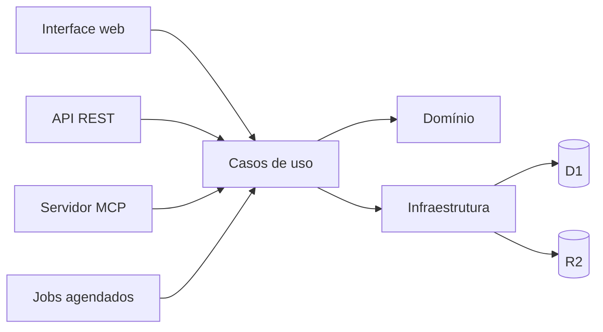

# Mapa da arquitetura

Este documento descreve a estrutura técnica do projeto. Consulte os módulos e testes correspondentes para confirmar o comportamento vigente; não é evidência de publicação ou configuração de um ambiente externo. Este projeto não oferece integração com G4 OS.

## Visão geral

## Camadas e responsabilidades

- `src/app/`: rotas e composição de páginas do App Router.
- `src/modules/<contexto>/domain/`: regras e modelos sem dependência de interface ou infraestrutura.
- `src/modules/<contexto>/application/`: casos de uso e coordenação de regras de domínio.
- `src/modules/<contexto>/infrastructure/`: persistência, consultas, projeções e dados demonstrativos.
- `src/modules/<contexto>/presentation/`: telas e componentes de cada contexto de negócio.
- `src/server/`: autenticação, autorização, persistência D1/R2, APIs e tarefas de servidor.
- `src/shared/`: componentes e utilitários compartilhados.
- `migrations/`: evolução do esquema relacional; `tests/`: testes de comportamento, integração e arquitetura.

Os contextos principais são `catalog`, `clients`, `delivery`, `documents`, `engagement`, `knowledge` e `workspace`. Regras de dependência são verificadas pelos testes de arquitetura e detalhadas nos arquivos `AGENTS.md` próximos ao código.

## Persistência e operações

A persistência combina documentos versionados e tabelas relacionais/projeções, conforme o contexto. Migrações e adaptadores de infraestrutura definem a forma persistida. Alterações de formato devem manter compatibilidade ou incluir migração e testes.

Escritas de negócio devem passar pelos casos de uso e operações de servidor aplicáveis, que concentram validação, autorização, concorrência, idempotência e registro de eventos. Não presumir atomicidade entre operações separadas: verificar a operação concreta e seus testes.

Arquivos binários são tratados separadamente dos metadados de negócio. A autorização deve ser verificada antes de disponibilizar conteúdo; referências e exclusão seguem as regras do contexto de documentos.

## API, autenticação e integrações

A API REST e o servidor MCP reutilizam operações de negócio quando disponíveis. Seus contratos, escopos e exemplos genéricos estão em [Operação via API e MCP](api-mcp-operacao.md) e [OAuth](oauth-api-mcp.md). A existência de um endpoint ou integração opcional no código não implica que esteja configurada em cada implantação.

Autenticação, autorização e permissões têm fontes próprias no servidor e no domínio de workspace. Mudanças devem atualizar a matriz e seus testes. A chave mestra vem do ambiente de execução. Credenciais Composio/Z-API são informadas em Configurações e cifradas no D1; nunca ficam em código, fixtures ou arquivos versionados.

## Verificação e manutenção

Use os testes automatizados e os comandos documentados no [guia de contribuição](guia-de-contribuicao.md). Testes com mocks ou fixtures não comprovam comportamento em serviços externos ou ambientes publicados. Registre apenas decisões técnicas duráveis; não publique dados de clientes, identificadores de ambientes, evidências operacionais privadas ou medições internas.

## Conectores configuráveis após deploy

- `composio.ts` e `/api/composio/*`: configuração administrativa, criação explícita de Auth Configs gerenciados, contas por workspace/membro e callback de verificação de identidade do provedor. Somente ferramentas de leitura da allowlist são executadas, com versão descoberta, argumentos filtrados e limites de resposta. Tokens OAuth ficam no Composio; a API key fica cifrada em `composio_settings` (0044). Chamadas externas não são transações D1 e mutações incertas não são repetidas automaticamente.
- `z-api.ts`, `/api/z-api/*` e 0045: configuração administrativa cifrada, webhook de segredo exclusivo, validação de instância, associação explícita de conversa e cliente, deduplicação e retenção de 90 dias. A propriedade do cliente é gravada junto à mensagem: remapear um canal não expõe mensagens históricas do dono anterior. O webhook não depende do login interativo Access, mas exige seu próprio segredo.
- `whatsapp.ts`, `insight-context.ts` e operações WhatsApp: o servidor resolve o cliente autorizado para a fonte Supabase ou para o canal local `z-api:*`. Leituras revalidam autorização e associação; jobs usam o mesmo cursor de importação e pipeline de insights. Cron também elimina capturas Z-API expiradas.
- `auth.ts`: Access valida assinatura RS256, issuer, AUD, expiração e identidade. A plataforma exige membro ativo ou o e-mail administrativo de bootstrap. Um autosave inicial exatamente vazio é reconhecido como no-op; não cria documento nem concede permissões.
- `scripts/deploy.mjs`: provisiona/reutiliza D1 antes das migrações e só então publica o Worker; R2 é provisionado pelo Wrangler. Configurações de login no painel são preservadas por `keep_vars`.

Os testes simulam os provedores. Consentimento OAuth real e entrega Z-API exigem validação pelas contas da empresa instaladora.
